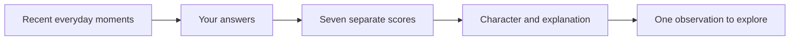

# 7 Deadly Sins Test: Meanings, Scores & Self-Reflection

A **7 deadly sins test** turns familiar situations into a profile of pride, envy, wrath, sloth, greed, gluttony, and lust. Its most useful question is not whether you are a good person. It is which reactions you recognize, when they appear, and what your answers leave out.

If you want to explore your own pattern, the official Seven Sides website offers a free [7 deadly sins test](https://7deadlysinstest.xyz/): 21 everyday questions, an original alter ego, seven scores, and an illustrated result card. This guide explains how to answer thoughtfully and make sense of the result without letting a dramatic label define you.

*Demonstration result card exported from Seven Sides; for entertainment and reflection.*

## What does a 7 deadly sins test actually tell you?

A 7 deadly sins quiz asks you to recognize yourself in descriptions of behavior. You might consider how you respond to correction, whether someone else's progress unsettles you, or how often a short scrolling break becomes much longer than planned.

The result summarizes those responses. It cannot establish the causes of your behavior or reveal everything about your personality. A high score means stronger agreement with the situations included in that particular questionnaire. A low score can mean the descriptions did not fit your recent experience.

The traditional names come from Christian moral teaching; the [Catechism's list of capital sins](https://www.vatican.va/archive/ENG0015/__P6D.HTM) includes the same seven themes. Seven Sides uses them as prompts for entertainment and reflection. You do not need religious knowledge, and the quiz does not assess your faith.

## The seven themes, translated into everyday situations

Before taking a 7 deadly sins test, read what its labels mean. Ordinary words can carry broader meanings than the questions actually cover. Here is how the Seven Sides version frames them.

| Theme | Everyday pattern explored | A useful distinction |
|---|---|---|
| **Pride** | Defending your view before considering feedback, or dwelling on unnoticed achievements. | Feeling pleased with good work does not automatically mean difficulty accepting correction. |
| **Envy** | Measuring your progress against someone else's opportunities, achievements, or online highlights. | Admiring a friend and feeling dissatisfied with yourself are different experiences. |
| **Wrath** | Answering small frustrations sharply or continuing to replay an argument. | Disagreement alone does not show how quickly you react or how long frustration stays. |
| **Sloth** | Avoiding an uncomfortable task even when time and energy are available. | Needing rest or lacking resources is a different situation from avoiding a possible first step. |
| **Greed** | Wanting more after your needs are met or struggling to let an unused opportunity go. | The questions concern your relationship with enough, rather than your income. |
| **Gluttony** | Continuing an enjoyable activity beyond the stopping point you intended. | Here the examples include scrolling and watching; the score is not a judgment about body size. |
| **Lust** | Letting a new attraction redirect your attention or hurry decisions. | Attraction itself is not treated as a problem; the questions concern your chosen pace. |

These distinctions make a 7 deadly sins quiz more useful. Someone who enjoys a quiet weekend need not interpret that preference as avoidance. Someone who values achievement can still listen openly to criticism. Read the situation before deciding whether the label sounds flattering or uncomfortable.

## How to answer without chasing a particular result

For a more useful 7 deadly sins test experience, choose a consistent timeframe. Seven Sides asks about the past four weeks. Think about ordinary moments across that period, rather than only your best day or one unusually difficult interaction.

Use the five response options to describe how closely each statement fits. There are no correct personality answers to uncover. If you want to choose the response that produces a favorite character, pause and recall an actual example instead.

A practical approach:

1. **Name the situation.** Recall the meeting, message, unfinished task, or distracting conversation behind your answer.
2. **Consider a contrasting example.** One sharp reply does not describe every discussion you had that month.
3. **Use the whole scale.** Choose an extreme when it fits, rather than because you feel forced to pick a side.
4. **Skip a poor fit.** Select “This situation doesn't apply to me” instead of guessing. Each side needs at least two usable answers.

The 7 deadly sins quiz has no timer. You can reconsider a response or pause in the same browser tab. Taking longer is fine; the point is to recognize a pattern you can discuss, not finish quickly.

## How to read your 7 deadly sins test scores

Start with all seven scores, then read the headline. In Seven Sides, each group has three statements with equal weight among the usable answers. Choices receive values from zero to four. One statement in each group describes the opposite behavior, so its value is reversed before averaging.

The average is multiplied by 25 to produce a score out of 100. Here is an illustrative calculation, not a real person's result:

| Scoring step | Example |
|---|---|
| First ordinary item | 3 |
| Second ordinary item | 2 |
| Opposite-direction item answered 1 | Reversed value: 4 − 1 = 3 |
| Average of adjusted values | (3 + 2 + 3) ÷ 3 = 2.67, approximately |
| Group score | 66.67 out of 100, approximately |

On this 7 deadly sins test, 67 out of 100 does **not** mean “67% sinful,” a 67% probability of a trait, or a rank above 67% of other people. The seven scores are independent and do not need to total 100.

Skipped items are left out of the average. With two usable answers instead of three, each remaining answer has more influence. The explanation helps you see which responses supported a tendency and which pointed away from it. You can review the [7 deadly sins test scoring guide](https://7deadlysinstest.xyz/#scoring) alongside your profile.

*Illustrative sample: each tendency has its own score, rather than a share of a single total.*

## Which deadly sin am I if my scores are close?

A 7 deadly sins test does not need to force a winner. Two close scores can describe overlapping patterns, while an even profile may have no clear leading tendency. Broadly high or low responses also deserve context instead of an arbitrary label.

Seven Sides translates these patterns into original editorial characters. A leading pride profile can become **The Velvet Crown**; a profile without a strong standout may become **The Seven-Sided Original**. These names make the result memorable, but they are not scientific personality categories.

When a 7 deadly sins quiz gives you a surprising result, ask which answers produced it. Did several situations fit, or did one response have an outsized effect? Did you interpret a statement differently after seeing the explanation? Those questions are more useful than deciding whether you “really are” the character.

*Illustrative sample: The Velvet Crown is an original editorial character, not a psychological category.*

## Turn the result into one small observation

After a 7 deadly sins test, choose a situation you can notice in daily life. Keep the experiment small enough to recognize when it happens.

If recognition stood out, notice what you do when feedback arrives. If comparison stood out, write down the specific thing you admired before judging your own progress. If avoidance stood out, identify one concrete beginning rather than describing yourself as lazy.

You might keep a brief note: **situation → first reaction → chosen response**. For example, “A colleague corrected my draft → I wanted to explain immediately → I asked what they thought was missing.” This is a reflection prompt, not a treatment plan or a promise of personal change.

## Share the conversation, not a judgment

A 7 deadly sins quiz can give friends a fresh starting point for conversation. Ask, “Which question reminded you of something?” rather than “Which of us is worse?” Different routines and interpretations can matter as much as the numerical gap.

Seven Sides lets you choose Playful or Gentle wording for an illustrated card, add a nickname, and save a portrait or story PNG. Including all seven scores is optional. A result link with scores enables side-by-side comparison after your friend completes the same quiz version.

Before sharing a 7 deadly sins test result, check the information you selected. Individual answers are not included in the link, but anyone holding it can read the shared result. Links cannot be revoked, and your friend's result is not automatically sent back to you.

## Questions before you begin

### Is the complete experience free?

Yes. Seven Sides includes the questionnaire, character reading, detailed profile, card downloads, and comparison without an account or payment screen. There is no email requirement to reveal your result.

### Is this an anime character match?

No. This 7 deadly sins test explores the traditional themes through everyday situations. Its original alter egos are separate from characters in the anime or manga, and no trivia knowledge is needed.

### How accurate is it?

Seven Sides is an original entertainment questionnaire, not an independently validated psychological instrument. Its calculations explain your selected responses; they do not establish a diagnosis, fixed identity, or moral worth.

### Can I retake it or save progress?

You can retake the quiz after confirming that the current attempt will be replaced. Progress may survive a refresh in the same tab when browser storage is available. Closing the tab can remove it, and there is no account sync or saved attempt history.

### Why could another quiz give a different result?

A different 7 deadly sins quiz may use different definitions, questions, response scales, or rules for selecting a leading side. Compare what you were asked and how the answers were summarized before comparing the labels.

Ready to explore your own examples? Take the official Seven Sides [7 deadly sins quiz](https://7deadlysinstest.xyz/#test), then read the answers behind the character. Bring curiosity, take your time, and keep the result in perspective.

---

**Seven Sides:** [GitHub](https://github.com/happydrew/7-deadly-sins-test) · [Pinterest](https://www.pinterest.com/veogen/) · [LinkedIn](https://www.linkedin.com/in/drew-grant-200528328/) · [Contact support](mailto:support@7deadlysinstest.xyz)
